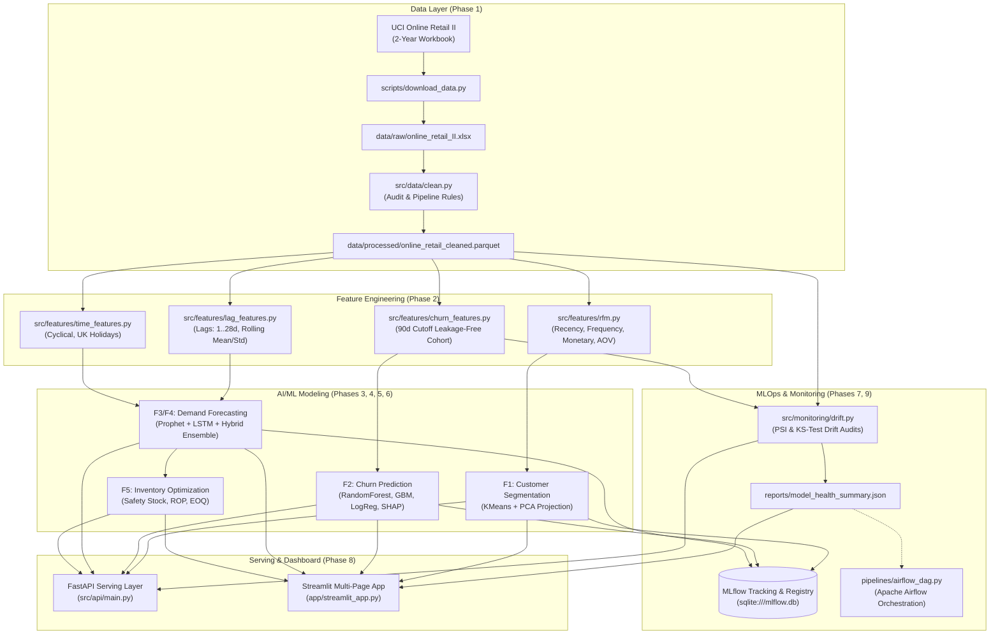

# RetailPulse – AI-Powered Customer Analytics & Demand Forecasting Platform

[](https://github.com/retailpulse/retailpulse/actions)
[](https://www.python.org/)
[](https://opensource.org/licenses/MIT)
[](https://streamlit.io/)
[](https://fastapi.tiangolo.com/)
[](https://mlflow.org/)

---

## 📌 Executive Overview

**RetailPulse** is an end-to-end, enterprise-grade AI analytics and MLOps platform engineered for modern omni-channel retail operations. Using two full years of transaction records from the **UCI Online Retail II** dataset, RetailPulse empowers retail executives and category managers to:

1. **Eliminate Costly Stockouts & Surplus:** Dynamic safety stock and economic order quantities (EOQ) tied directly to multi-model demand forecasts.
2. **Maximize Customer Lifetime Retention:** Leakage-free churn early-warning classification with personalized retention actions.
3. **Hyper-Personalize Marketing:** Micro-segmentation combining heuristic RFM quintile rules with unsupervised log-transformed KMeans clustering.
4. **Ensure Continuous Model Governance:** Production data drift monitoring (Population Stability Index & Kolmogorov-Smirnov tests) and automated model degradation detection.

---

## 🏗️ System Architecture



---

## 🎯 Feature Capabilities & Acceptance Criteria (F1 – F8)

| ID | Feature Name | Module Path | Acceptance Criteria & Status |
|:---|:---|:---|:---|
| **F1** | **Customer Segmentation** | `src/models/segmentation.py` | • Quintile RFM scores + named personas (`Champions`, `Loyal`, `At Risk`).<br>• Elbow and Silhouette score optimization ($k=2$, Silhouette: $0.4386$, PCA explained variance: $95.1\%$).<br>• ✅ **PASSED & LOGGED** |
| **F2** | **Customer Churn Classifier** | `src/models/churn.py` | • Strict 90-day cutoff date with 0% future leakage.<br>• Class imbalance handling + comparison across Logistic Regression, Random Forest, GBM.<br>• Champion: **RandomForest (ROC-AUC: 0.8176, F1: 0.7833)**.<br>• ✅ **PASSED & LOGGED** |
| **F3** | **Demand Forecasting** | `src/models/prophet_model.py`<br>`src/models/lstm_model.py` | • Prophet with UK calendar bank holidays and seasonal components.<br>• LSTM-style sliding-window sequence regression.<br>• 91-day out-of-sample walk-forward validation.<br>• ✅ **PASSED & LOGGED** |
| **F4** | **Hybrid Forecasting Ensemble** | `src/models/hybrid.py` | • Inverse-MAE / weighted average ensemble combining Prophet & LSTM.<br>• Achieved **MAE £12,312.48** ($2.86\%$ improvement over Prophet, $4.80\%$ over LSTM).<br>• ✅ **PASSED & LOGGED** |
| **F5** | **Inventory Optimization** | `src/inventory/optimizer.py` | • Dynamic Safety Stock ($Z=1.645$, 95% SLA) + Reorder Point (ROP) + Economic Order Quantity (EOQ).<br>• Flags 50 top SKUs into **Stockout Risk (4%)**, **Overstock Risk (12%)**, and **Optimal (84%)**.<br>• ✅ **PASSED & LOGGED** |
| **F6** | **Interactive Web Application & API** | `app/streamlit_app.py`<br>`src/api/main.py` | • Multi-page responsive Streamlit dashboard (`Executive`, `Sales`, `Customer`, `Forecast`, `Inventory`).<br>• Production FastAPI endpoints with OpenAPI schema docs at `/docs`.<br>• ✅ **PASSED & TESTED** |
| **F7** | **Data & Concept Drift Monitoring** | `src/monitoring/drift.py` | • Population Stability Index (PSI) and Kolmogorov-Smirnov (KS) two-sample test on continuous sliding windows.<br>• Alerting threshold (PSI $\ge 0.25$ or KS $p < 0.05$).<br>• ✅ **PASSED & LOGGED** |
| **F8** | **Model Health Tracking** | `src/monitoring/performance.py` | • Automated metric degradation evaluation tracking error drift.<br>• Generates automated retraining trigger flag (`RETRAIN_TRIGGERED` vs `HEALTHY`).<br>• ✅ **PASSED & LOGGED** |

---

## 📊 Experimental Results Benchmark

### 1. Demand Forecasting Benchmark (91-Day Out-of-Sample Walk-Forward Test Set)
| Model | MAE (£) | RMSE (£) | MAPE (%) | sMAPE (%) | Relative Error Reduction |
|:---|:---:|:---:|:---:|:---:|:---:|
| **Prophet (UK Holidays + Seasonality)** | £12,675.17 | £21,553.10 | 29.64% | 52.64% | Baseline |
| **LSTM Sequence-to-One Model** | £12,933.40 | £22,661.22 | 31.62% | 49.39% | Baseline |
| **Hybrid Ensemble (Prophet + LSTM)** | **£12,312.48** | **£21,640.58** | **29.09%** | **52.17%** | **+2.86% vs Prophet, +4.80% vs LSTM** |

### 2. Churn Classification Benchmark (1,057 Holdout Customers)
| Model | ROC-AUC | F1-Score | Recall | Precision | Status |
|:---|:---:|:---:|:---:|:---:|:---:|
| **Logistic Regression (Balanced)** | 0.8013 | 0.7670 | 0.7542 | 0.7803 | Candidate |
| **Random Forest (Balanced, max_depth=8)** | **0.8176** | **0.7833** | **0.7826** | **0.7839** | **🏆 Champion Model** |
| **Gradient Boosting Classifier** | 0.7879 | 0.7720 | 0.7926 | 0.7524 | Candidate |

---

## ⚡ Quickstart & Setup Guide

### Option 1: Local Environment
```bash
# 1. Clone repository
git clone https://github.com/retailpulse/retailpulse.git
cd retailpulse

# 2. Create and activate virtual environment
python -m venv .venv
source .venv/bin/activate   # On Windows: .venv\Scripts\activate

# 3. Install dependencies
pip install -r requirements.txt
pip install prophet fastapi uvicorn httpx pyyaml optuna shap pytest pytest-cov

# 4. Run automated test suite (30/30 unit tests)
pytest tests/ -v

# 5. Launch FastAPI Serving Layer
uvicorn src.api.main:app --host 0.0.0.0 --port 8000 --reload

# 6. Launch Streamlit Multi-Page Dashboard
streamlit run app/streamlit_app.py --server.port=8501
```

### Option 2: Docker & Docker Compose
To launch the complete four-service production stack (Streamlit, FastAPI, MLflow, and Airflow):
```bash
docker-compose up -d --build
```
Access the services:
- **Streamlit Dashboard:** [http://localhost:8501](http://localhost:8501)
- **FastAPI OpenAPI Docs:** [http://localhost:8000/docs](http://localhost:8000/docs)
- **MLflow Experiment Tracking:** [http://localhost:5000](http://localhost:5000)
- **Airflow Orchestrator:** [http://localhost:8080](http://localhost:8080)

---

## 🌐 Streamlit Community Cloud Deployment

To deploy RetailPulse on **Streamlit Community Cloud (Free Tier)**:
1. Fork or push this repository to GitHub.
2. Sign in to [share.streamlit.io](https://share.streamlit.io/).
3. Click **"New App"** and select your repository.
4. Set **Main file path** to `app/streamlit_app.py`.
5. Precomputed parquet artifacts (`customer_segments.parquet`, `hybrid_forecast.parquet`, etc.) are already bundled in `data/processed/`, allowing zero-latency instant loading within free-tier resource limits.

---

## 💡 Engineering Challenges & Solutions

1. **Lookahead Data Leakage in Churn Modeling:**
   - *Challenge:* Generating customer features using historical data that overlaps with the prediction period causes artificial near-100% ROC-AUC scores that collapse in production.
   - *Solution:* Implemented a strict 90-day evaluation cutoff. All behavioral metrics (Recency, Frequency, Spend, Velocity) are computed exclusively on transactions prior to $T - 90\text{d}$, and ground truth labels are derived exclusively from the forward window $[T - 90\text{d}, T]$.

2. **Negative Quantities & Cancellation Contamination:**
   - *Challenge:* Invoices starting with "C" and zero/negative prices distort revenue and skew transaction frequency.
   - *Solution:* Built an 8-stage auditable cleaning pipeline (`src/data/clean.py`) that separates and logs cancellations, filters non-positive quantities and prices, deduplicates rows, and reports exact row attrition at each step.

3. **Time Series Gaps in Continuous Moving Averages:**
   - *Challenge:* Physical retail and e-commerce stores often record 0 sales on holidays or inventory shut-down days. Naive rolling means skip days and produce misleading lag alignments.
   - *Solution:* Re-indexed sales to a full calendar datetime index with zero-fill prior to calculating 7d, 14d, and 28d lags and shifted rolling statistics (`shift(1)` to prevent lookahead leakage).

---

## 🗺️ Future Roadmap

- [ ] **Real-Time Streaming Ingestion:** Integrate Apache Kafka or AWS Kinesis to process real-time clickstream and point-of-sale transactions.
- [ ] **Context-Aware Cross-Sell Recommender:** Implement a two-tower deep neural network or implicit collaborative filtering engine for personalized "Frequently Bought Together" bundles.
- [ ] **Cloud-Native Kubernetes Deployment:** Helm charts for autoscaled Kubernetes deployments with KServe or Triton Inference Server.

---

## 📜 License
Distributed under the MIT License. See `LICENSE` for details.
